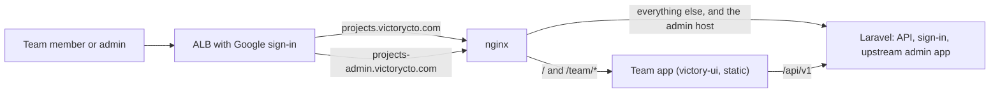

# VictoryCTO changes to Invoice Ninja

This fork runs https://projects.victorycto.com, replacing Avaza for project
management, time tracking and invoicing. Status and go-live checklist:
issue #4. Reporting needs: issue #3.

## Evaluation period

The owner confirmed on 2026-11-05 that the team will evaluate Invoice Ninja
before switching. Avaza remains the source of truth and the hourly mirror stays
enabled. Keep real time tracking in Avaza; direct Invoice Ninja test entries may
be overwritten by an import. `EVALUATION_MODE` in `victory-ui/src/config.ts`
shows this notice before and after sign-in. Remove it only as part of an approved
cutover with a final sync, clean reconciliation and the hourly mirror disabled.

The existing timesheet pivots and CSV downloads cover the owner's reporting
requirements. The one-time 180-day archive completed on 2026-11-05: a fresh
preview found 37 qualifying projects, leaving 13 active. The earlier preview
had found 38; the exact-count guard stopped that outdated run before any writes.
The hourly mirror preserves this archive and restores a project if new Avaza
time is logged. This is independent of cutover.

Inactive companies intentionally deleted in Twenty stay retired there. The
mirror retains their saved mappings and Invoice Ninja history, skips CRM writes
for those companies and their contacts, and resumes CRM mirroring if the same
Twenty record is restored. New Avaza companies still import normally.

The owner confirmed that users should leave task notes in Ninja during
evaluation. The task panel keeps screenshots, imported Avaza discussion and a
native note form together. Native notes live in `victory_task_notes`, share
across person-specific copies within the same project, and survive source
refreshes. They are test data for the later full wipe/resync. No reset is
authorized until evaluation is complete.

## Server changes (kept small so they rebase onto each upstream release)

| Setting / endpoint | What it does | Code |
|---|---|---|
| `OIDC_ONLY=true` | Refuses password and passkey login, signup, social-token login and password reset (403). Google sign-in only. | `app/Http/Middleware/OidcOnly.php`, routes |
| `OIDC_ALLOWED_DOMAINS=victorycto.com` | OIDC callback refuses other email domains; for Google the `hd` claim must be present and match. | `LoginController::refuseOidcUserOutsideAllowedDomains` |
| `HIDE_FINANCIALS_FROM_NON_ADMINS=true` | API responses for non-admins zero project rates and budget amounts, task rates and invoice links, and client balances. Those fields are also ignored on task and project updates from non-admins, so saving a whole record in the upstream app cannot write the zeros back. | `app/Utils/FinancialVisibility.php`, Project/Task/Client transformers |
| `GET /api/v1/victory/time_entries` | Time entries flattened to one row per entry for a date range, filterable by person, project and client. Non-admins only get their own. | `app/Http/Controllers/Victory/TimeEntryController.php` |
| `POST /api/v1/victory/admin_handoff` + `VICTORY_ADMIN_URL` | Gives admins a one-shot code so the upstream admin app opens without a second sign-in. | `app/Http/Controllers/Victory/AdminHandoffController.php` |
| `PUT /api/v1/victory/tasks/{task}/content` | Admin-only content import; updates description and Avaza metadata while preserving time and billing. | `app/Http/Controllers/Victory/TaskContentController.php` |
| `GET/POST /api/v1/victory/tasks/{task}/notes` | Team notes, scoped by company, project and task visibility; independent of imported metadata. | `app/Http/Controllers/Victory/TaskNoteController.php` |

Tests: `tests/Feature/Auth/OidcOnlyTest.php`, `tests/Feature/FinancialVisibilityTest.php`,
`tests/Feature/Victory/VictoryEndpointsTest.php`. The `victory-ci` workflow runs them (and the team
app's lint, tests and build) on every push to `victory/**`.

## Two front ends, one backend

- **Team app** (`victory-ui/`): the default for everyone. Projects (cards or list),
  tasks (board or list), an always-visible time tracker, My tasks, Time (with entry
  editing), Reports (timesheet pivot and CSV downloads over `/victory/time_entries`). Served
  from `public/team` at the root of projects.victorycto.com. Sign-in callbacks
  land on it (`REACT_URL=https://projects.victorycto.com/team`).
- **Upstream admin app**: unmodified, at projects-admin.victorycto.com, reached
  from the team app's Admin link (admins only) through `admin_handoff`.
- Time is logged on tasks, not people, so each person times their own copy of
  a shared task; the team app shows the copies as one card.

## Releases

Run **Actions → release → Run workflow** (pick the branch, default
`victory/team-app`). It creates the next tag `v<upstream version>-victory.<n>`
(for example `v5.13.49-victory.3`) and runs `build-image` for it. Pushing such a
tag by hand still works too. The `build-image` workflow builds the release tarball (Composer, upstream React app,
team app into `public/team`), publishes it as a GitHub release, builds the
official Debian image for arm64 without the Saxon extension, and pushes it to
ECR `invoiceninja`. Deploy by setting `image_tag` in
twenty-crm-infra `stacks/invoiceninja`, then run `docs/victory/smoke.sh https://projects.victorycto.com [API_TOKEN]`:
health, OIDC-only, the team app shell, the victory endpoints, and (with a team member's token) that money is zeroed.

## Upstream maintenance

The owner chose to continue with Invoice Ninja for its PHP backend, Google
authentication and MCP integration, while keeping the custom interface. Keep
extensions under the Victory namespace and separate tables; use supported APIs
for integrations. Keep changes to existing upstream behavior small and covered
by the fork's regression tests. Avoid modifying core time/billing semantics to
add collaboration features.

`upstream-compatibility` reports merge conflicts against the latest stable
upstream release on each pull request and can also be run manually. It compares
trees using `VERSION.txt` as the upstream base, without updating the branch or
running migrations. Conflict warnings are informational so an upstream release
does not block unrelated fixes; failures to run the check fail the job.

For an actual upgrade, resolve the upstream merge in an isolated branch, run
server and UI checks, validate database migrations and representative migrated
tasks in staging, then release and deploy through the infrastructure PR plan.
A clean text merge alone does not establish runtime compatibility.

MCP belongs in an API adapter rather than core task/billing classes. The
`billing-tools/docs/invoiceninja-admin-runbook.md` documents the current external
stdio adapter and dedicated API token setup; its default mode is read-only.
Keep Google-only browser sign-in and role-based data access intact when adding
integration tools. Check MCP tool contracts alongside the API when upgrading;
do not treat documented setup instructions as proof of a live connection.

## Integrated Julia workspace

The shared `@victory/workspace` UI lives in `workspace-ui/`. The standalone host
is `/team/#/workspace`; Julia pins the same package tarball. Repack and update
both hosts when changing the shared component. The existing team screens and
upstream admin app remain available.

`VICTORY_PROJECT_ACCESS_ENABLED=true` enables explicit project grants for
non-admin users. With no grants they see no projects, regardless of broad native
view permissions. Native permissions still apply. Admins manage grants through
`GET /api/v1/victory/access/users` and `PUT .../users/{hashed_user_id}`; roles are
viewer, contributor, and manager. Empty assignments revoke all project access.
Changes are transactional and audited in `victory_access_audit`. The same policy
covers direct APIs, task sorting, notes, and time entries; other non-admin API
surfaces are denied. Test restricted users before enabling the flag.

Only an authenticated administrator token named exactly `julia-workspace` can
supply `X-Victory-Actor: <verified-user-email>`. The backend resolves one active
user in the same account/company and applies that user's current identity,
native permissions, and project grants. Julia supplies this header server-side;
never expose the token in a browser or accept an actor email from a client form.
The additive migration must run before enabling project access.

`GET /api/v1/victory/workspace` returns the shared UI's allowlisted snapshot.
`POST /api/v1/victory/tasks/{task}/workspace` supports atomic field edits and
owned timer start/stop, preserving unrelated time and financial fields. Timer
commands serialize per person and reject a competing running task. During
Julia evaluation, writable pilot projects carry `custom_value4` equal to
`julia-workspace-pilot`. Avaza remains the production source until cutover.

Restricted legacy task writes accept only delivery/time fields and keep the
record's time owner, project and client bindings unchanged. Creating or replacing
another person's time, moving time-bearing records, and financial edits require
native application administration. Shared description/status edits use the
atomic workspace command endpoint. The standalone owned tracker remains
supported. When financial hiding is enabled, client setting overrides are also
withheld from non-admin responses; they can contain private rate information.

Session bootstrap also limits company settings to display identity and locale
for non-admin users when financial hiding is enabled. Billing defaults and
invoice configuration stay server-side; stored settings and administrator
responses are unchanged.

With project enforcement enabled, legacy timer starts and active time-log writes
lock the time owner and use the same competing-timer check as workspace
commands, including for administrators. The shared Workspace screen uses its
own timer controls; the legacy tracker remains on the older team screens.

Timer operations normalize the single active interval to the end of a task log
without changing interval values. This avoids the upstream equal-timestamp sort
edge case on repeated start/stop cycles. Timer reads use current row locks after
the owner lock; multiple existing active intervals require explicit Time review.
