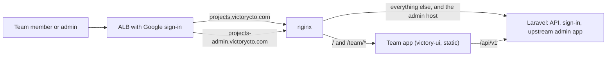

# VictoryCTO changes to Invoice Ninja

This fork runs https://projects.victorycto.com, replacing Avaza for project
management, time tracking and invoicing. Status and go-live checklist:
issue #4. Reporting needs: issue #3.

## Server changes (kept small so they rebase onto each upstream release)

| Setting / endpoint | What it does | Code |
|---|---|---|
| `OIDC_ONLY=true` | Refuses password and passkey login, signup, social-token login and password reset (403). Google sign-in only. | `app/Http/Middleware/OidcOnly.php`, routes |
| `OIDC_ALLOWED_DOMAINS=victorycto.com` | OIDC callback refuses other email domains; for Google the `hd` claim must be present and match. | `LoginController::refuseOidcUserOutsideAllowedDomains` |
| `HIDE_FINANCIALS_FROM_NON_ADMINS=true` | API responses for non-admins zero project rates and budget amounts, task rates and invoice links, and client balances. Those fields are also ignored on task and project updates from non-admins, so saving a whole record in the upstream app cannot write the zeros back. | `app/Utils/FinancialVisibility.php`, Project/Task/Client transformers |
| `GET /api/v1/victory/time_entries` | Time entries flattened to one row per entry for a date range, filterable by person, project and client. Non-admins only get their own. | `app/Http/Controllers/Victory/TimeEntryController.php` |
| `POST /api/v1/victory/admin_handoff` + `VICTORY_ADMIN_URL` | Gives admins a one-shot code so the upstream admin app opens without a second sign-in. | `app/Http/Controllers/Victory/AdminHandoffController.php` |

Tests: `tests/Feature/Auth/OidcOnlyTest.php`, `tests/Feature/FinancialVisibilityTest.php`,
`tests/Feature/Victory/VictoryEndpointsTest.php`. The `victory-ci` workflow runs them (and the team
app's lint, tests and build) on every push to `victory/**`.

## Two front ends, one backend

- **Team app** (`victory-ui/`): the default for everyone. Projects (cards or list),
  tasks (board or list), an always-visible time tracker, My tasks, Time (with entry
  editing), Reports (timesheet pivot and CSV downloads over `/victory/time_entries`). Served
  from `public/team` at the root of projects.victorycto.com. Sign-in callbacks
  land on it (`REACT_URL=https://projects.victorycto.com/team`).
- **Upstream admin app**: unmodified, at projects-admin.victorycto.com, reached
  from the team app's Admin link (admins only) through `admin_handoff`.
- Time is logged on tasks, not people, so each person times their own copy of
  a shared task; the team app shows the copies as one card.

## Releases

Run **Actions → release → Run workflow** (pick the branch, default
`victory/team-app`). It creates the next tag `v<upstream version>-victory.<n>`
(for example `v5.13.49-victory.3`) and runs `build-image` for it. Pushing such a
tag by hand still works too. The `build-image` workflow builds the release tarball (Composer, upstream React app,
team app into `public/team`), publishes it as a GitHub release, builds the
official Debian image for arm64 without the Saxon extension, and pushes it to
ECR `invoiceninja`. Deploy by setting `image_tag` in
twenty-crm-infra `stacks/invoiceninja`.

Upgrading upstream: rebase the `victory/*` commits onto the new upstream tag,
run the tests above, tag, deploy.
